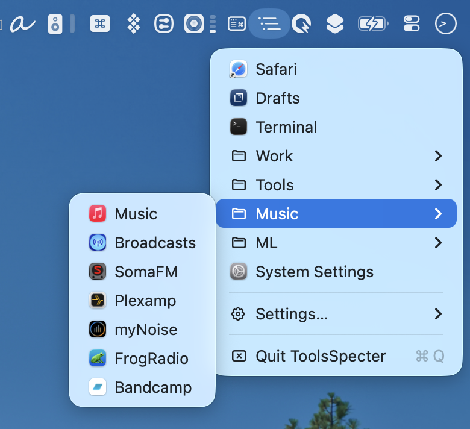

# ToolsSpecter

A hierarchical launcher menu for the macOS menu bar, inspired by **ToolsDaemon** on the Amiga — a user-arranged tree of text menus that launches your apps and tools from anywhere.

ToolsSpecter lives in the menu bar as the Applications “A” and the word **Apps** — or just one of them. Click it and your top-level groups appear as titles running right-to-left across the menu bar, matching the system appearance; hover a title to drop its menu, or click it. Group items into folders and submenus, launch apps/files/URLs or run shell tools, all without touching the Dock or Spotlight.

Choose **Icon and Text**, **Icon Only**, or **Text Only** — plus the word itself and a classic single-menu mode — under **Settings… → Menu Bar** (right-click the word). **Option-clicking** the word opens the classic menu directly.



## Editing your menu

Every launcher is arranged visually in the built-in editor — nest items into folders, reorder with drag & drop, or drag apps straight in from Finder.


## Features

- **Horizontal menu bar** — click the word or icon (default Applications “A” + “Apps”); folder titles expand right-to-left and dropdowns open on hover, with the menu bar’s own font and colors
- **Classic menu** — Option-click the word, or choose Settings… → Menu Bar → Classic Menu, for the original single drop-down
- **Hierarchical text menus** — organize launchers into folders and nested submenus, the ToolsDaemon way
- **Menu bar residence** — a lightweight status-bar item (no Dock icon); the Finder-style Applications “A”, your own word, or both, with a one-click vertical-menu toggle
- **Launch anything** — applications, files, URLs, and shell commands
- **Real app icons** in the menu
- **Built-in app scanning** of `/Applications`, `/System/Applications`, `~/Applications`, and `~/Apps`, plus **Scan Folder…** to add any other location
- **Visual editor** (Settings… → Edit menu…) — add apps/folders/URLs/files/shell tools/separators, rename, reorder, nest and move items via drag & drop, or drag apps straight in from Finder
- **Live config** — every change is saved to `~/Library/Application Support/ToolsSpecter/config.json` and reflected the next time the menu opens
- **Open at Login** support
- No Xcode project needed — build with a single script

> **macOS 26:** if the word is missing, allow ToolsSpecter under **System Settings → Menu Bar → Allow in the Menu Bar**. If you use a menu bar manager such as Thaw or Ice, make sure ToolsSpecter isn’t in its hidden section.

## Requirements

- macOS 13+
- Xcode Command Line Tools (for `swift build`)

## Install (from a release)

Download the latest `ToolsSpecter-<version>-macOS.zip` from the [Releases](https://github.com/Trez-zerT/ToolsSpecter/releases) page — the zip is a **universal binary** that runs on both Apple Silicon and Intel Macs. Unzip and move `ToolsSpecter.app` into `/Applications`.

The app is **not notarized**, so macOS may block the first launch. Fix it once with any of these:

**Option A — allow it in System Settings** (macOS 14+)

Try to launch the app once — macOS will show a block message. Then open **System Settings → Privacy & Security** and, under **Security**, click **Open Anyway** next to the note that ToolsSpecter was blocked.

**Option B — clear the download quarantine** (most reliable)

```sh
xattr -dr com.apple.quarantine /Applications/ToolsSpecter.app
```

Either option lets the app launch. For **Open at Login** to work, the app must live in `/Applications`.

## Build from source

```sh
./scripts/make-app.sh
open build/ToolsSpecter.app
```

The script compiles in release mode for the current machine's architecture, assembles `build/ToolsSpecter.app`, and ad-hoc codesigns it.

To build a **universal** binary (Apple Silicon + Intel) and package the release zip:

```sh
./scripts/make-release.sh
```

To enable **Open at Login**, move the app into place first:

```sh
cp -R build/ToolsSpecter.app /Applications/
```
